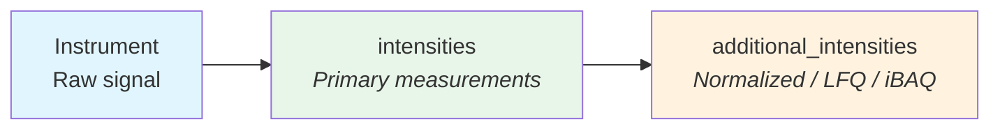

# Intensities

Intensity values in QPX are captured through two complementary fields: `intensities` for primary/raw measurements and `additional_intensities` for processed values produced by upstream tools. This separation enforces a clean boundary between **experimental design** (which channels and samples were measured) and **data processing** (values computed by the quantification tool, such as normalized intensities, LFQ, or iBAQ). QPX does not compute these values — it reads and stores them from the upstream tool's output.

## Semantic separation



| Field | Contains | Semantics |
| ----- | -------- | --------- |
| `intensities` | Raw intensity values from the instrument or quantification tool | Experimental design: channels, samples, raw measurements |
| `additional_intensities` | Normalized, LFQ, iBAQ, or other values computed by the upstream tool or a later step | Data processing: values read from the tool's output, not computed by QPX |

This design means a data consumer can always find the raw measurement in `intensities` and any post-processed variants in `additional_intensities`, regardless of the tool that produced the file.

## Primary intensities

The `intensities` field is an array of structs. Each element represents one intensity measurement for a specific label within a single reference file.

### Struct definition

```text
intensities: array[struct{
    label:          string,  -- Label identifier (e.g. "LFQ", "TMT126", "ITRAQ114")
    intensity:      float    -- Raw intensity value; null when identified but not quantified
}]
```

### TMT example

In a TMT-10plex experiment, a single feature row contains one intensity per label -- each label maps to a different biological sample via the SDRF.

```json
[
  {"label": "TMT126",  "intensity": 15234.7},
  {"label": "TMT127N", "intensity": 18902.3},
  {"label": "TMT127C", "intensity": 12045.1},
  {"label": "TMT128N", "intensity": 22310.5},
  {"label": "TMT128C", "intensity": 9871.6}
]
```

### LFQ example

In a label-free quantification experiment, each feature row has a single intensity value. The label is set to `"LFQ"` by convention.

```json
[
  {"label": "LFQ", "intensity": 98765.4}
]
```

### Label vocabulary

`label` takes the canonical names below, which come from the sdrf-pipelines channel map. Labels are compared exactly, case included: `iTRAQ114` and `ITRAQ114` give different `pg_id` values and only one joins its sample, so converters write the canonical spelling, and `qpxc validate` warns about any other label and names the canonical one when only the case differs.

The SDRF readers bring common spellings to these names: `TMT10plex_126`, `TMTpro-134C`, `iTRAQ4plex-114`, the ontology form `NT=TMT126;AC=PRIDE:0000114` and a bare reporter mass (`126` is `TMT126`, `114` is `ITRAQ114`: iTRAQ reporters stop at 121 and TMT starts at 126). Any other spelling stays as written and no intensity joins to it.

<!-- label-vocabulary -->
| Family | Labels |
|---|---|
| Label-free | `LFQ` |
| TMT | `TMT126`, `TMT127`, `TMT127N`, `TMT127C`, `TMT127D`, `TMT128`, `TMT128N`, `TMT128C`, `TMT128ND`, `TMT128CD`, `TMT129`, `TMT129N`, `TMT129C`, `TMT129ND`, `TMT129CD`, `TMT130`, `TMT130N`, `TMT130C`, `TMT130ND`, `TMT130CD`, `TMT131`, `TMT131N`, `TMT131C`, `TMT131ND`, `TMT131CD`, `TMT132N`, `TMT132C`, `TMT132ND`, `TMT132CD`, `TMT133N`, `TMT133C`, `TMT133ND`, `TMT133CD`, `TMT134N`, `TMT134C`, `TMT134ND`, `TMT134CD`, `TMT135N`, `TMT135ND`, `TMT135CD` |
| iTRAQ | `ITRAQ113`, `ITRAQ114`, `ITRAQ115`, `ITRAQ116`, `ITRAQ117`, `ITRAQ118`, `ITRAQ119`, `ITRAQ121` |
| SILAC | `SILAC light`, `SILAC medium`, `SILAC heavy` |
| mTRAQ | `MTRAQ0`, `MTRAQ4`, `MTRAQ8` |
| Dimethyl | `DIMETHYL0`, `DIMETHYL2`, `DIMETHYL4`, `DIMETHYL6`, `DIMETHYL8` |

NeuCode, 15N and other schemes have no canonical name yet: write the SDRF `comment[label]` value as it stands, which `qpxc validate` reports with a warning, and agree on a name upstream in the sdrf-pipelines channel map.

### MS1 labels (SILAC, dimethyl, mTRAQ)

Partners of an MS1-label multiplet are the same peptide with different isotope
labels, quantified side by side in one run. QPX encodes them as follows:

- **One feature row per multiplet per run.** `intensities` has one entry per
  channel label, using the canonical labels of the sdrf-pipelines channel map
  (`SILAC light`, `SILAC medium`, `SILAC heavy`, `DIMETHYL0`…`DIMETHYL8`,
  `MTRAQ0`/`MTRAQ4`/`MTRAQ8`), and each label resolves to its sample through
  `run.samples`.
- **The feature peptidoform is the lightest partner's**: no SILAC label, the
  lightest dimethyl or mTRAQ label inline. The identity composite is unchanged
  and one multiplet has one `feature_id`. `calculated_mz`, `observed_mz` and
  `mass_error_ppm` describe that partner, as MaxQuant reports them.
- **`feature.identified_labels`** lists the labels whose partner was identified
  by MS/MS (MaxQuant `Labeling state`); the others were quantified by their
  isotope pattern only.
- **`feature.channel_details`** holds what was measured of each partner, one
  entry per label: its `mz`, `rt`, `qvalue` and the tool's `evidence` score. DIA-NN
  fills all of them from `Channel.Q.Value` (else `Q.Value`) and `Channel.Evidence`,
  and `qpxc convert openms-consensus` the m/z and retention time of each sub-feature.
  `feature.representative_label` names the channel whose report row gave the row's
  scores and retention time, where a tool reports one row per channel.
- **A PSM is the identified partner.** `psm.peptidoform` carries its label
  modifications, `psm.label` names its channel, and `psm.feature_id` links it to
  the multiplet's feature row (the peptidoforms differ by design). The PSM label
  is one of the feature's `identified_labels`.
- **Ratios** go on the numerator label's entry as `ratio_<num>_<den>`, with
  `<num>` and `<den>` the lower-case channel suffixes (`l`, `m`, `h` for SILAC,
  the mass offset for dimethyl and mTRAQ): `ratio_h_l` and
  `ratio_h_l_normalized` on the `SILAC heavy` entry. The denominator label is
  the reference.
- **One sample may carry several labels** (pulsed SILAC, spike-in standards);
  the labels stay separate entries, and consumers must not sum them.

```json
[
  {"label": "SILAC light", "intensity": 107210000.0},
  {"label": "SILAC heavy", "intensity": 95337000.0}
]
```

### Missing values

An entry with a null `intensity` marks a label the feature was identified in but not quantified,
such as a MaxQuant MS/MS-only evidence row or an empty reporter channel of an identified plex.
A label with no entry was not identified or has no sample in the run, and a feature with no
entry at all has a null `intensities` list. A `0` entry is a measured zero: converters write the
zeros a tool uses as a "not quantified" sentinel as null instead. `NaN`, infinite and negative
values are not valid intensities. The protein-group view follows the same rule with one row per
label (see [Protein Group](pg.md)).

A value the tool imputed instead of measuring is an ordinary entry with its label in
`feature.imputed_labels`, or a pg row with `is_imputed` true. `build_mudata()` adds those cells as
the layer `imputed_mask`.

!!! note
    For LFQ experiments, each feature row corresponds to one MS run and one sample, so the `intensities` array has at most one element. For multiplexed experiments (TMT, iTRAQ), the array contains one element per measured label.

## Additional intensities

The `additional_intensities` field stores values computed from the primary ones -- normalized intensities, LFQ values, iBAQ values, and so on. Converters read these from the tool's output files (e.g., MaxQuant's `proteinGroups.txt`, DIA-NN's report) and store them as-is. See [Derived quantities](#derived-quantities) for values computed after the conversion. Each element mirrors the label structure of primary intensities but adds a nested array of named intensity types.

### Struct definition

```text
additional_intensities: array[struct{
    label:          string,  -- Matches the corresponding primary intensity entry
    intensities:      array[struct{
        intensity_name:  string,  -- Algorithm or metric name (e.g. "normalize_intensity")
        intensity_value: float    -- Value from upstream tool
    }]
}]
```

A label normally has a primary entry too, whose `intensity` may be null: a label-free MaxQuant feature identified by MS/MS only keeps its `spectral_count` under the label `LFQ`, whose intensity is null.

### Example

```json
[
  {
    "label": "LFQ",
    "intensities": [
      {"intensity_name": "normalize_intensity", "intensity_value": 0.1234},
      {"intensity_name": "lfq", "intensity_value": 23456.7},
      {"intensity_name": "ibaq", "intensity_value": 4567.8}
    ]
  },
  {
    "label": "LFQ",
    "intensities": [
      {"intensity_name": "normalize_intensity", "intensity_value": 0.1456},
      {"intensity_name": "lfq", "intensity_value": 25890.2},
      {"intensity_name": "ibaq", "intensity_value": 5102.3}
    ]
  }
]
```

### Intensity names

Each `intensity_name` has one meaning, including its level: a name on a feature row is a value of that precursor unless it starts with `pg_`, which marks a value of the feature's protein group repeated on its rows. Protein-group names are in [Recommended Intensity Names](pg.md#recommended-intensity-names). Tool-specific names are acceptable when no name below fits, in `snake_case`.

| `intensity_name` on a feature | Source tool(s) | Description |
|---|---|---|
| `normalize_intensity` | DIA-NN | The tool's normalised precursor quantity (`Precursor.Normalised`) |
| `ms1_area` | DIA-NN | MS1 area of the precursor |
| `spectral_count` | MaxQuant, Proteome Discoverer | MS/MS scans of the evidence row (`MS/MS count`), or the precursor's PSMs |
| `reporter_intensity_corrected` | MaxQuant (TMT/iTRAQ) | Isotope-purity-corrected reporter intensity |
| `ms1_intensity` | FragPipe, Proteome Discoverer (TMT/iTRAQ) | MS1 intensity of the precursor, once per feature under its first quantified channel |
| `ratio_<num>_<den>` | MaxQuant, OpenMS | Ratio of two labels of a multiplet, on the numerator label |
| `pg_maxlfq` | DIA-NN | MaxLFQ quantity of the protein group (`PG.MaxLFQ`) |
| `pg_quantity` | Spectronaut | Quantity of the protein group (`PG.Quantity`) |

### Derived quantities

A quantity computed after the conversion at the view's own granularity, one value per row and label, may be added to `additional_intensities` under its own `intensity_name`, with a `provenance` step naming the tool, the method and the views it wrote. A row per method or per scope does not fit: it breaks the primary key and counts the unit twice. Quantities at another granularity, such as a protein matrix over samples, belong in an [absolute expression](absolute.md) file, which `qpxc transform quantify -o result.h5ad` writes; its `.parquet` and `.tsv` outputs are plain tables, not QPX views.

### Scope of a value

Some values depend on the whole analysis they were computed in, not only on the row:

| Field or name | Computed over |
|---|---|
| `pg.global_qvalue`, `feature.global_qvalue`, `feature.pg_global_qvalue` | The dataset |
| `pg.intensity` and `maxlfq`, `lfq`, `ibaq` where the tool normalizes across runs | The runs quantified together |
| `pg.sequence_coverage`, and `pg.peptide_counts` where the tool reports one experiment-wide count | The dataset, and the unit where the tool reports per experiment (MaxQuant) |
| `pg.pg_accessions`, the group itself | The dataset: protein inference depends on the peptides seen |

So a dataset converted in batches and merged is not the dataset converted once: the same group can have other coverage, other members and a MaxLFQ value more than 7 % away. `merge()` warns when it merges pg views, and each source keeps its `source_dataset`; its origin is the `analysis_id` of its `dataset` view.

### Processing state

The primary intensities' processing is stated on the tool's step in the [provenance view](provenance.md), when the converter knows it, as the `parameters` keys `isotope_corrected` (`true`/`false`, for isobaric reporter intensities) and `normalization` (`none`, or the tool's value). No key means the input does not say. Compare intensities across datasets only when these agree.

## When to use which field

| Scenario | Use `intensities` | Use `additional_intensities` |
| -------- | ------------------ | ---------------------------- |
| Raw reporter ion signal from TMT channels | Yes | -- |
| Single MS1 precursor intensity in LFQ | Yes | -- |
| Median-normalized intensity | -- | Yes |
| MaxLFQ protein intensity | -- | Yes |
| iBAQ value | -- | Yes |
| Algorithm-specific rescaled intensity | -- | Yes |

## Where intensities are used

| View                          | Primary intensity | `additional_intensities` | Notes |
| ----------------------------- | :---------------: | :----------------------: | ----- |
| Feature (`feature_file`)      | `intensities` (list) | Yes                   | Per-feature, per-run; one struct element per label |
| Protein Group (`pg_file`)     | `intensity` (scalar) | Yes                   | **Flattened since QPX 1.1**: one row per label, scalar `label` + `intensity` — no `intensities` list |
| Protein Summary (`protein_file`) | `abundance`       | --                       | Uses a single float per sample instead |

!!! warning "PG is flattened — no `intensities` list"
    The `intensities: list<{label, intensity}>` struct on this page describes the
    **feature** view. Since QPX 1.1 the protein-group view is **flattened**: each
    row carries scalar `label` + `intensity` columns and there is one row per
    `(pg_accessions, grouped_runs, label)`. `label`/`intensity` are null for
    identification-only groups. See [Protein Group](pg.md) and the
    [Data Model](data-model.md).

!!! note
    The Protein Summary view uses a simpler `abundance` field (a single float per sample) rather than the full intensities struct, since it serves as a lightweight report format.

## Further reading

- [Scores & CV Terms](scores.md) -- additional structured metadata for features and protein groups
- [QPX Format Overview](index.md) -- full list of views and concepts

## Reading intensities

The nested layout costs nothing on disk but takes work to read, more for many labels. In a TMT16 feature view, selecting one channel with `list_filter` takes about 34 times as long as reading a flat column, and through Polars about 115 times.

| Need | Use | Cost |
|------|-----|------|
| Long table: one row per feature and label | `feature.peptide_intensities()` | Unnests every row in DuckDB |
| Wide table: one column per label | `feature.intensities_wide(labels=[...])` | Same; naming the labels spares a scan for them |
| Whole view in pandas | `feature.to_df(dtype_backend="pyarrow")` | Columns stay in Arrow memory |
| Whole view in pandas, as Python objects | `feature.to_df()` | About 8 KB per TMT16 row: 2.4 GB for 300,000 rows |

Filter before reading: `feature.by_run(...)` and `feature.by_protein(...)` narrow the scan, which helps every option above.
