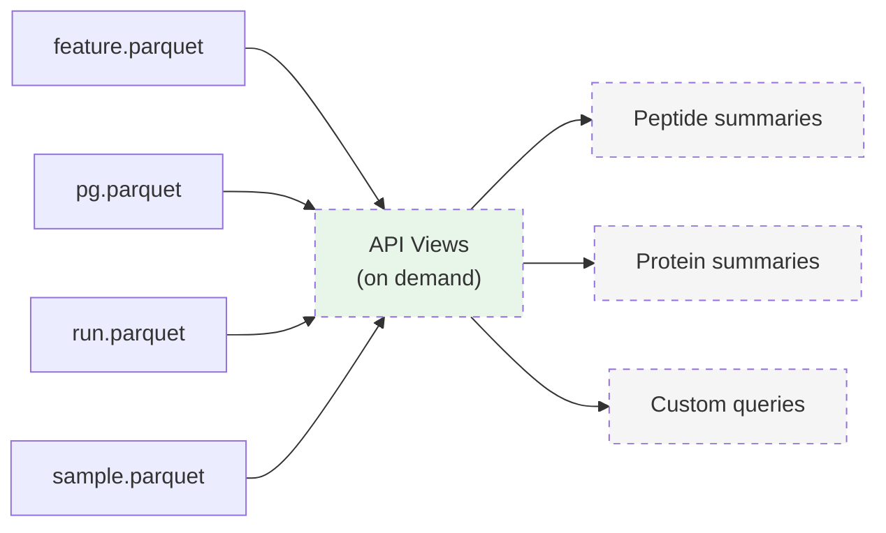

# API Views

API views are **not** stored as standalone Parquet files. They are derived, on-demand views that the API computes at query time by joining and aggregating the primary data views (`psm.parquet`, `feature.parquet`, `pg.parquet`) with the metadata views (`run.parquet`, `sample.parquet`).

!!! info "Programmable, not prescriptive"
    Unlike the primary data views which have fixed YAML schemas, API views are **programmable**. The API can expose different fields, aggregations, and summaries depending on the use case. There is no rigid response schema -- what you retrieve is determined by your query.

## Concept

The QPX primary views (PSM, Feature, Protein Group) store the full, detailed data. API views sit on top of these and provide **convenience summaries** tailored to specific needs:

- A **peptide-level summary** might aggregate features across runs into one abundance value per peptide per sample.
- A **protein-level summary** might roll up protein group data into protein counts, abundances, and identification metrics per sample.
- A **custom view** might combine fields from multiple primary views to answer a specific question.

The key insight is that the primary data model is rich enough to derive many different summaries. Rather than defining a fixed schema for each possible summary, the API allows users to request exactly the data they need.

## Examples of what you can retrieve

Because views are programmable, different users can request different slices of the data:

| Use case | What you might request |
|----------|----------------------|
| Quick protein report | Protein accessions, gene names, number of peptides per protein |
| Abundance comparison | Protein accessions, abundance per sample, global q-values |
| Peptide coverage | Peptide sequences, modifications, which proteins they map to |
| Identification summary | Number of proteins, number of peptides, number of PSMs per sample |
| Sample overview | Per-sample counts and total intensities |

## How views are derived

API views are computed by joining and aggregating the primary QPX data. For example:

**Protein-level data** can be derived from the PG view by:

1. Joining `pg.parquet` with `run.parquet` to resolve sample-channel mappings.
2. Keying each row by its group membership (`pg_accessions`, sorted); `anchor_protein` is only a display label, since one protein can lead several groups.
3. Reading the per-label intensity directly from the flattened scalar `pg.intensity` (since QPX 1.1 the PG view has one row per label — there is no `intensities` list).
4. Optionally aggregating peptide/PSM counts, scores, or gene annotations.

```sql
-- Example: deriving protein abundance per sample from pg + run
WITH run_samples AS (
    SELECT r.run_file_name, sc.label, sc.sample_accession
    FROM 'PXD014414.run.parquet' r
    CROSS JOIN UNNEST(r.samples) AS samples(sc)
)
SELECT array_to_string(list_sort(pg.pg_accessions), ';') AS protein_group,
       pg.anchor_protein AS protein_accession,
       rs.sample_accession,
       pg.label,
       pg.intensity AS abundance,
       pg.global_qvalue,
       pg.gg_names
FROM 'PXD014414.pg.parquet' pg
JOIN run_samples rs
  ON rs.run_file_name = pg.grouped_runs[1]
 AND rs.label = pg.label;   -- flattened: scalar pg.label/pg.intensity, no intensities list
```

Any member run of `grouped_runs` resolves the label to the unit's sample, so
joining on the first one returns the protein-group quantity once per sample and
label, without unnesting every fraction against every channel.

**Peptide-level data** can be derived from the Feature view by:

1. Joining `feature.parquet` with `run.parquet` to resolve sample-channel mappings.
2. Aggregating features across files and channels into a single abundance per sample.
3. Optionally joining with `pg.parquet` for gene annotations.

```sql
-- Example: deriving peptide abundance per sample from feature + run
WITH run_samples AS (
    SELECT r.run_file_name, sc.label, sc.sample_accession
    FROM 'PXD014414.run.parquet' r
    CROSS JOIN UNNEST(r.samples) AS s(sc)
),
feature_intensities AS (
    SELECT f.sequence, f.peptidoform, f.run_file_name, i.label, i.intensity
    FROM 'PXD014414.feature.parquet' f
    CROSS JOIN UNNEST(f.intensities) AS _i(i)
)
SELECT fi.sequence,
       fi.peptidoform,
       rs.sample_accession,
       fi.intensity AS abundance
FROM feature_intensities fi
JOIN run_samples rs
  ON rs.run_file_name = fi.run_file_name
 AND rs.label = fi.label;
```

Both lists are flattened before the join, so the sample is matched on
`(run_file_name, label)`. Unnesting `run.samples` and `intensities` in the same
`FROM` clause as the join instead plans a product of features and samples. In a
single-sample run the API views also take a feature label that matches no sample,
such as DIA-NN's `raw`, as that sample. For gene annotations, join `pg` through the
feature-to-pg softlink (`Dataset.link_feature_pg()`: membership, run and label), not
on `anchor_protein`, which can lead several groups.

## Relationship to primary views



!!! tip "Use primary views for full detail"
    API views are for convenience and fast lookups. For full detail -- per-file intensities, scan references, protein group inference context, spectral data -- always use the primary views directly: [PSM](psm.md), [Feature](feature.md), [Protein Group](pg.md), [Mass Spectra](mz.md).

## Built-in API Views

The Python API provides several pre-built views accessible as properties on the `Dataset` object:

| View | Property | Data Method | Description |
|------|----------|-------------|-------------|
| Identification Summary | `ds.identification_summary` | `.summary()` | Per-run protein group, peptide, and feature counts |
| Run Summary | `ds.run_summary` | `.summary()` | The same per-run counts, cached |
| Modification View | `ds.modification_view` | `.frequency()` | Modification frequency across PSMs |
| QC View | `ds.qc_view` | `.metrics()` | Dataset-wide quality control metrics |
| Sample Summary | `ds.sample_summary` | `.peptides_per_run()`, `.peptides_per_sample()`, `.proteins_per_sample()` | Peptide and protein group counts per run and sample |
| Protein View | `ds.protein_view` | `.intensity(q_value_threshold=None)` | Protein group abundance per sample (joins PG + Run) |
| Peptide View | `ds.peptide_view` | `.intensity()` | Peptide abundance per sample (joins Feature + Run) |

All of them leave decoys out and count protein groups by their membership, not by
`anchor_protein`. A sample is resolved through the label of each quantity, so in a
multiplexed run a peptide counts for the channels that carry it, not for every
sample of the run. `protein_view.intensity()` applies no q-value filter unless
`q_value_threshold` is given. A view over a structure the dataset lacks raises a
`ValueError` naming it.

`.intensity()` returns a lazy result. `.filter("protein_group = 'P1;P2'")` narrows it
in SQL, which DuckDB pushes into the scans, so a lookup does not read the whole view
first; iterating a result, or `fetchone()`, streams its rows in batches.

### Abundance matrices

`Dataset.intensity(level)` returns the long-form abundance (`sample_accession`,
`label`, `unit`, `feature_id`, `intensity`) and `Dataset.design_matrix(level)`
pivots it into samples by analytes. Decoys are left out.

- **Analyte.** A protein is its group: `feature_id` is the sorted membership joined
  by `;`, so two groups led by the same protein stay two columns. A peptide is its
  `peptidoform` by default; `key="precursor"` adds the charge and `key="sequence"`
  merges the modified forms.
- **Unit.** The runs that hold the same samples (accession, label and technical
  replicate) are the fractions of one quantification unit, named after its first
  run, and their quantities are summed. Technical replicates, and a bridge sample in
  several plexes, are separate units.
- **Rows.** `by="sample"` (the default) gives one row per sample, combining its units
  with `agg` (`"mean"` by default; also `"median"`, `"sum"`, `"min"`, `"max"`). It logs
  a warning when a unit carries one sample under several labels, such as the light
  and heavy channels of pulsed SILAC, since those are combined too. `by="unit"` gives
  one row per (`sample_accession`, `label`, `unit`) and keeps them apart.
- **Missing cells** stay NaN unless `fillna` is given.
- **Quantity.** `value_col="intensity"` (the default) pivots the primary quantity;
  the `intensity_name` of an additional intensity, such as `"lfq"`, pivots that one.

```python
proteins = ds.design_matrix("protein")                        # samples x groups
units = ds.design_matrix("peptide", key="precursor", by="unit")
ds.design_matrix("protein", output_path="matrix.parquet")     # out-of-core pivot
```

`ds.protein_view.intensity()` reports the same group key as `protein_group` next to
the anchor `protein_accession`. To select one group, use `ds.pg.by_group([...])` or
`ds.feature.by_group([...])`; `by_protein()` matches the anchor and so returns every
group the protein leads.

### Plotting

Each summary view has a `.plot()` method that returns a `plotly` `Figure` for quick visualization. Plotly is imported lazily -- it is only required when `.plot()` is called (`pip install qpx[plotting]`).

```python
import qpx

ds = qpx.open_dataset("PXD014414/")

# Identification summary bar chart
fig = ds.identification_summary.plot()
fig.write_html("identifications.html")

# Run summary grouped bar chart
fig = ds.run_summary.plot()

# QC metrics overview
fig = ds.qc_view.plot()

# Modification frequency (top 20 by PSM count)
fig = ds.modification_view.plot(top_n=20)

# Peptides or protein groups per sample
fig = ds.sample_summary.plot(metric="proteins_per_sample")
```

!!! tip "Customization"
    `ModificationView.plot()` takes `top_n`, the number of modifications shown, and `SampleSummaryView.plot()` takes `metric`. Change the returned figure with plotly's own API (`fig.update_layout(width=1400)`), or retrieve the data with `.summary().to_df()` and build your own plots. Saving as an image (`fig.write_image`) needs the `kaleido` package.

## Dataset Collections

For multi-dataset analysis, `DatasetCollection` registers multiple datasets in a single DuckDB engine. Each structure is indexed by dataset number (e.g., `feature_0`, `feature_1`).

### Virtual Mode (Cross-Dataset SQL)

```python
import qpx

ds1 = qpx.open_dataset("PXD014414/")
ds2 = qpx.open_dataset("PXD016999/")

coll = qpx.DatasetCollection([ds1, ds2])

# Query across datasets; feature_0 and feature_1 read one dataset each
result = coll.sql("SELECT source_dataset, COUNT(*) AS n_features FROM feature GROUP BY source_dataset")
print(result.to_df())

# See what structures are available per dataset
print(coll.structure_names)
# {0: ['feature', 'pg', 'sample', 'run', 'dataset'], 1: ['feature', 'pg', ...]}
```

### Physical Merge

Merge matching structures from multiple datasets into a new directory. The rows
are streamed through the QPX writers, so the output has QPX footers and row
groups and respects the collection's memory limit.

```python
coll.merge("merged_output/", structures=["feature", "pg"])

# Open the merged dataset
merged = qpx.open_dataset("merged_output/")
df = merged.feature.to_df()
print(df["source_dataset"].value_counts())
```

Datasets that share a run, a sample or a primary key would count those rows
twice, so `on_collision` decides what happens:

| `on_collision` | Behaviour |
| --- | --- |
| `"error"` (default) | Refuses before writing, and names what the datasets share. |
| `"namespace"` | Keeps both. Run names, sample accessions and the other names that link rows become `<source>:<name>`, and ids are rewritten per source, so links between views still resolve. |
| `"dedupe-identical"` | For copies of the same data: a row whose key is already written is dropped if identical. A key with different values raises, and so do rows that are not identical in a run another dataset also has, which are two analyses of it. |

Each view has its own merge rule:

| View | Result |
| --- | --- |
| `psm`, `feature`, `pg`, `mz`, `site`, `proteoform`, `sample`, `run` | The rows of every dataset, with a `source_dataset` column: the project accession, else the directory name. |
| `dataset` | One row. `project_accession` joins the accessions with `;`. |
| `provenance` | The steps of every dataset, numbered through, with `source_dataset`, then a `merge_datasets` step. |
| `ontology` | One row per field and view, joining the source tools and columns. A field with different terms keeps the first, with a warning. |
| `pepmap` | One row per peptidoform, with the proteins of every dataset. |

Footers keep the identity composite of the sources. Datasets with different
composites give one file per composite (`merged-1.feature.parquet`, ...), which
are read as one view, because a footer declares one composite.

!!! note "Common structures only"
    When no `structures` argument is passed to `merge()`, only structures present in **all** datasets are merged, and a warning names the others.
