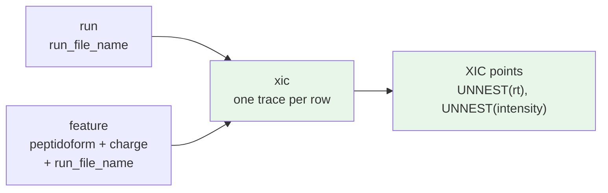

# Extracted-Ion Chromatograms (XIC) View

An **extracted-ion chromatogram (XIC)** is the intensity of one precursor or fragment ion as a function of retention time. In DIA experiments every quantified precursor is supported by such traces, and they are the evidence behind a peak boundary, an apex, an area, and a shape-based score. The `xic` view stores these traces as a first-class QPX data view so they can be exported by DIA tools, validated, joined to features, and plotted without re-extracting from the raw file.

## Why trace-level rows

The view stores **one row per chromatogram trace**, not one row per retention-time point. A trace is a single entity: it has one precursor, one transition annotation, and one run. Storing it as a row with aligned `rt`/`intensity` arrays (and an optional per-point `mz`) has three practical advantages over the long `(precursor, transition, rt, intensity)` form emitted by DIA-NN:

- **One row per entity.** A DIA-NN XIC export for one 2-hour run has ~1.8 million point rows; the same data is ~350,000 trace rows here (the diann-export test run: 27,009 precursors, 348,418 traces). Fewer rows mean fewer repeated precursor/transition strings and a row that matches the entity consumers reason about.
- **One fetch per plot.** A viewer asking for one precursor's traces reads a handful of rows instead of scanning a precursor's worth of points.
- **Per-trace operations are natural.** Apex, area, RT span, and point count are computed without a `GROUP BY` over millions of rows.

The row reduction does not by itself guarantee a smaller file: the long Parquet form already dictionary-encodes the repeated strings, and in the DIA-NN test export the trace-level QPX file was about 10% larger (~6.7 MB vs ~6.1 MB). The gain is in query shape and entity semantics, not compression.

Point-level access is still one `UNNEST` away; see [Querying](#querying).

!!! note "Aligned arrays and point rules"
    `rt`, `intensity` and, when present, `mz` MUST have the same length within a row; element `i` is the measurement at `rt[i]`. Retention times are stored in **seconds**, are **raw run RTs** (not aligned or iRT-corrected), and must be **strictly increasing**. Validation reports length mismatches as `chromatogram_length_mismatch` and non-increasing RTs as `rt_not_increasing`. Zero-intensity points are kept, and QPX does not smooth the arrays; a producer that smooths should declare it in the file metadata. Note that `mz.scan_start_time` is in minutes while `xic.rt` and `feature.rt` are in seconds.

!!! note "Selection and size"
    A trace-level file is not automatically smaller than a long export. More importantly, the `17 GB` projection in the proposal assumes DIA-NN apex windows (~5 points per trace). A full extraction window (e.g. ±300 s) has tens of times more points per trace and can make the file hundreds of GB, approaching the size of the inline spectra. The XIC file therefore declares its selection in the footer: `xic_selection` (`targets`, `targets_and_decoys`, `all`), `xic_window` (`apex`, `full`), optionally `xic_extraction_window_seconds` and `xic_qvalue_threshold`, and `transition_format` (default `mzPAF`). Rescoring that needs decoys or sub-threshold targets must use an export that contains them.

## Schema

See the full YAML schema in [`xic.yaml`](schemas/xic.yaml).

### Identity and links

| Field | Description | Type | Required |
|-------|-------------|------|----------|
| `xic_id` | Opaque identifier of the trace, unique within the file; the primary key | `string` | Yes |
| `run_file_name` | Raw file containing the trace (without extension); links to `run`, `feature`, `psm`, `mz` | `string` | Yes |
| `label` | Channel label: `"LFQ"` for label-free DIA, or a reporter/plex label; matches `feature.intensities[].label` | `string` | Yes |
| `feature_ids` | Optional links to the `feature.feature_id` rows this trace supports; a trace can support several candidate peak groups | `array[int64]` | Optional |
| `feature_scores` | Per-feature scores for this trace (area, apex, mass error, shape, …) when they depend on the feature | `array[struct]` | Optional |
| `compensation_voltage` | FAIMS compensation voltage; part of the trace identity when the acquisition uses FAIMS | `float32` | Optional |

### Precursor identity

| Field | Description | Type | Required |
|-------|-------------|------|----------|
| `precursor_id` | Producer's precursor identifier, preserved verbatim (DIA-NN `pr`: modified sequence + charge) | `string` | Yes |
| `peptidoform` | Precursor in ProForma notation; links to `feature.peptidoform` and `psm.peptidoform` | `string` | Yes |
| `charge` | Precursor charge state | `int16` | Yes |

### Traced ion

| Field | Description | Type | Required |
|-------|-------------|------|----------|
| `transition` | Transition annotation: `"ms1"` for the precursor trace, or a fragment label such as `"y7^1"` / `"b4^2"`; fragment annotations follow mzPAF where the producer supports it | `string` | Yes |
| `transition_type` | `"ms1"` for the precursor trace, `"fragment"` for a fragment-ion trace | `string` | Yes |
| `fragment_type` | Fragment-ion series (`b`, `y`, …); null for MS1 traces | `string` | Optional |
| `fragment_number` | Fragment ordinal from the terminus (`y7` → `7`) | `int16` | Optional |
| `fragment_charge` | Charge of the traced fragment (`y7^1` → `1`) | `int16` | Optional |
| `neutral_loss` | Neutral-loss annotation (`-H2O`); null when none | `string` | Optional |
| `isotope` | Isotope index: `0` monoisotopic, `1` = M+1, …; applies to precursor and fragment traces | `int16` | Optional |
| `target_mz` | m/z the trace was extracted at: precursor m/z for `ms1`, product m/z for a fragment | `float32` | Optional |
| `target_rt` | Expected/target retention time in seconds (library or predicted apex) | `float32` | Optional |
| `rt_start` | Start of the extraction window in seconds | `float32` | Optional |
| `rt_stop` | End of the extraction window in seconds | `float32` | Optional |
| `target_ion_mobility` | Target ion-mobility value (1/K0) | `float32` | Optional |
| `ion_mobility_start` | Start of the ion-mobility extraction window (1/K0) | `float32` | Optional |
| `ion_mobility_stop` | End of the ion-mobility extraction window (1/K0) | `float32` | Optional |
| `library_intensity` | Library or predicted relative intensity of the fragment | `float32` | Optional |
| `used_for_quantification` | True when the producer used the trace for quantification/scoring, false when only extracted | `boolean` | Optional |

### Measurement and metadata

| Field | Description | Type | Required |
|-------|-------------|------|----------|
| `rt` | Raw retention times in seconds, strictly increasing; aligned with `intensity` and `mz` | `array[float32]` | Yes |
| `intensity` | Raw intensity at each retention time; zeros kept, not smoothed by QPX | `array[float32]` | Yes |
| `mz` | Optional observed m/z at each retention time, aligned with `rt` | `array[float32]` | Optional |
| `is_decoy` | Decoy flag for the precursor when the producer reports one | `boolean` | Optional |
| `additional_scores` | Trace-level producer scores that do not depend on a specific feature | `array[struct]` | Optional |
| `cv_params` | Trace-specific controlled-vocabulary metadata; run-level extraction settings belong in run/provenance metadata | `array[struct]` | Optional |

## Tracing one entity through QPX



| From | To | Join predicate |
|------|----|----------------|
| `xic` | `run` | `xic.run_file_name = run.run_file_name` |
| `xic` | `feature` | `xic.run_file_name = feature.run_file_name AND xic.peptidoform = feature.peptidoform AND xic.charge = feature.charge`; match `xic.label` to the feature's intensity label when multiplexed |
| `xic` | `feature` (direct) | `feature.feature_id IN xic.feature_ids` when the producer assigns them; a trace can support several candidate features |
| `xic` | `sample` | resolve `(run_file_name, label)` through `run.samples[]` exactly as for `feature` and `pg` |

`precursor_id` is kept for round-tripping to the source tool. Join on the normalized `peptidoform` + `charge`, not on `precursor_id`, because identifier syntax is tool-specific.

## Transition names

`transition` uses mzPAF-style fragment annotations where the producer supports them (`y7^1`, `b4^2`, neutral losses, isotopes); `ms1` is reserved for the precursor trace. The structured columns make the annotation queryable without string parsing:

| `transition` | `transition_type` | `fragment_type` | `fragment_number` | `fragment_charge` | `neutral_loss` | `isotope` |
|--------------|-------------------|-----------------|-------------------|-------------------|----------------|-----------|
| `ms1` | `ms1` | null | null | null | null | 0 |
| `y7^1` | `fragment` | `y` | 7 | 1 | null | 0 |
| `b4^2` | `fragment` | `b` | 4 | 2 | null | 0 |
| `y9-H2O^1` | `fragment` | `y` | 9 | 1 | `-H2O` | 0 |

## DIA-NN mapping

DIA-NN writes one `*.xic.parquet` per run with the columns `pr`, `feature`, `info`, `rt`, and `value`. Map it as follows.

| DIA-NN column | QPX field | Transformation |
|---------------|-----------|----------------|
| file name `<run>.xic.parquet` | `run_file_name` | strip the `.xic.parquet` suffix |
| `pr` | `precursor_id` | copy verbatim |
| `pr` | `peptidoform` + `charge` | strip the trailing charge; convert `(UniMod:N)` to ProForma `[UNIMOD:N]` |
| `feature` | `transition` | copy; `ms1` reserved for the precursor trace; reorder charge/loss to mzPAF (`y9^1-H2O` → `y9-H2O^1`) |
| `feature` | `transition_type`, fragment fields | `ms1` → `ms1`; `y7^1` / `b4^2` → `fragment` plus parsed fields |
| — | `isotope` | `0` (DIA-NN extracts monoisotopic targets) |
| `info` | — | `0` on signal rows; values `1..N` occur only on `feature = index` rows (see below) |
| `rt` | `rt` | multiply by 60 (DIA-NN reports minutes; QPX stores seconds) |
| `value` | `intensity` | copy |
| — | `label` | set to `"LFQ"` for label-free DIA-NN output |
| — | `xic_id` | `<run_file_name>|<pr>|<feature>|<isotope>|<compensation_voltage>` |
| — | `feature_ids` | optional; null unless the converter also links the trace to feature rows |
| — | `target_mz`, `target_rt`, windows, IM | not reported by DIA-NN XIC; null |
| — | `is_decoy` | optional, from the DIA-NN report/feature row |

The DIA-NN converter writes file-level selection metadata: `xic_selection=targets`, `xic_window=apex`, `xic_smoothed=false`, `xic_zero_points=kept`, `xic_rt_unit=seconds`, and `transition_format=mzPAF`. Override `--xic-selection`, `--xic-window`, `--xic-extraction-window-seconds` and `--xic-qvalue-threshold` when the export differs. `qpxc migrate` copies these keys with the traces; merging datasets keeps a key only when every source states the same value.

!!! warning "Exclude DIA-NN `index` rows"
    DIA-NN also writes rows with `feature = "index"`, `rt = 0`, and `value = 0`. They are **not chromatogram points**: they chunk the precursors in blocks of 128 and carry the block number in `info` (0, 1, 2, …). Discard them when building QPX traces; only `feature = "ms1"` and fragment labels are measurements.

## Example

One row for the `y7^1` fragment trace of a precursor:

```json
{
  "xic_id": "RD139_Narrow_UPS1_0_1fmol_inj1|PEPTIDEK2|y7^1|0|None",
  "run_file_name": "RD139_Narrow_UPS1_0_1fmol_inj1",
  "label": "LFQ",
  "feature_ids": [1048576],
  "feature_scores": null,
  "compensation_voltage": null,
  "precursor_id": "PEPTIDEK2",
  "peptidoform": "PEPTIDEK",
  "charge": 2,
  "transition": "y7^1",
  "transition_type": "fragment",
  "fragment_type": "y",
  "fragment_number": 7,
  "fragment_charge": 1,
  "neutral_loss": null,
  "isotope": 0,
  "target_mz": 842.4512,
  "target_rt": 63.52,
  "rt_start": 58.0,
  "rt_stop": 68.0,
  "target_ion_mobility": null,
  "ion_mobility_start": null,
  "ion_mobility_stop": null,
  "library_intensity": null,
  "used_for_quantification": true,
  "rt": [63.402126, 63.462021, 63.522034, 63.582001, 63.642014],
  "intensity": [25123.576, 43031.266, 49921.051, 38102.734, 22010.117],
  "mz": null,
  "is_decoy": false,
  "additional_scores": null,
  "cv_params": null
}
```

## Querying

Trace-level rows keep the common query simple:

```sql
-- All traces for one precursor in one run
SELECT transition, transition_type, rt, intensity
FROM 'PXD014414.xic.parquet'
WHERE run_file_name = 'RD139_Narrow_UPS1_0_1fmol_inj1'
  AND precursor_id = 'PEPTIDEK2';
```

Expand to points with DuckDB's zipped `UNNEST` (the arrays are aligned, so both unnest to the same length):

```sql
SELECT xic_id, transition, feature_ids,
       UNNEST(rt)        AS rt_seconds,
       UNNEST(intensity) AS intensity
FROM 'PXD014414.xic.parquet';
```

Compute an apex and a summed intensity per trace:

```sql
SELECT xic_id, transition,
       MAX_BY(rt_seconds, intensity) AS apex_rt,
       SUM(intensity)               AS summed_intensity,
       COUNT(*)                     AS points
FROM (
    SELECT xic_id, transition,
           UNNEST(rt)        AS rt_seconds,
           UNNEST(intensity) AS intensity
    FROM 'PXD014414.xic.parquet'
)
GROUP BY ALL;
```

Join the traces to their quantified features:

```sql
SELECT f.feature_id, f.anchor_protein, x.transition, x.rt, x.intensity
FROM 'PXD014414.feature.parquet' AS f
JOIN 'PXD014414.xic.parquet' AS x
  ON x.run_file_name = f.run_file_name
 AND x.peptidoform   = f.peptidoform
 AND x.charge        = f.charge
WHERE f.run_file_name = 'RD139_Narrow_UPS1_0_1fmol_inj1';
```

From Python, `Xic.points()` returns the expanded long form directly:

```python
from qpx import Dataset

ds = Dataset("PXD014414/")
ds.xic.by_precursor("PEPTIDEK2").to_df()       # one row per trace
ds.xic.by_precursor("PEPTIDEK2").points().to_df()  # one row per RT point
```

## Notes and boundaries

!!! note "DIA and targeted data only"
    The view describes extracted traces. It does not store DDA profile spectra; use the [mz view](mz.md) for those. A DIA feature may exist without an XIC (if the tool did not export traces), and `xic.feature_ids` is therefore optional.

!!! note "Multiplexed DIA"
    One trace is measured per channel. Emit one row per `label` and keep `label` equal to the feature's intensity label so the traces resolve to the right sample through `run.samples[]`. Label-free DIA uses the single label `"LFQ"`.

!!! note "RT-only; mobilograms are out of scope"
    `xic` stores intensity versus retention time. Mobilograms (intensity versus ion mobility at a feature apex) are a different axis and are not represented by the `rt`/`intensity` arrays; a future `xim` view should cover them. For diaPASEF XIC traces, the ion-mobility *window* is carried as per-trace scalars (`target_ion_mobility`, `ion_mobility_start`, `ion_mobility_stop`) without changing the RT axis.

!!! note "Feature links are many-to-many"
    A trace is precursor-level evidence and may support several candidate peak groups, so `feature_ids` is a list and may be null when the producer assigns no feature. Scores that depend on a feature go in `feature_scores` (one entry per `feature_id`), while `additional_scores` holds trace-level scores. The fallback join on `(run_file_name, peptidoform, charge[, label])` is not unique in general: the default feature identity includes `rt`, and FAIMS producers can include `compensation_voltage`. Use `feature_ids` when it is present, and treat the fallback as a precursor-level association rather than a row-level foreign key.

!!! note "Decoys"
    When a producer extracts traces for decoy precursors, keep them and set `is_decoy = true`; consumers filter explicitly. A null `is_decoy` means the trace was not classified.

## Converting DIA-NN XIC exports

DIA-NN writes one `*.xic.parquet` per run when `--xic` is enabled. Merge them into one QPX view with the standalone converter:

```bash
qpxc convert diann-xic \
    --xic-folder ./diann_xic \
    --output-folder ./qpx \
    --output-prefix PXD014414 \
    --xic-selection targets \
    --xic-window apex
```

To add the XIC view to a full report conversion, pass the same folder to the DIA-NN converter:

```bash
qpxc convert diann \
    --report-path report.tsv \
    --sdrf-file data.sdrf.tsv \
    --xic-folder ./diann_xic \
    --output-folder ./qpx
```

## File naming

The view follows the standard QPX convention:

```text
{PREFIX}.xic.parquet
```

For example, `PXD014414.xic.parquet`. A QPX dataset has **one** dataset-level XIC file for all runs, not one file per run: `run_file_name` identifies the run of each trace, and `xic_id` embeds it so traces from different runs stay unique. A DIA-NN per-run export is also named `<run>.xic.parquet`; convert those into the single dataset-level QPX XIC file rather than mixing raw DIA-NN exports into a QPX dataset directory.

## See Also

- [Feature View](feature.md) -- the quantified peaks these traces support.
- [Mass Spectra](mz.md) -- scan-level spectra for DDA and DIA.
- [Intensities](intensities.md) -- how `label` ties a quantity to a sample.
- [Serialization](serialization.md) -- Parquet encoding and file metadata.
